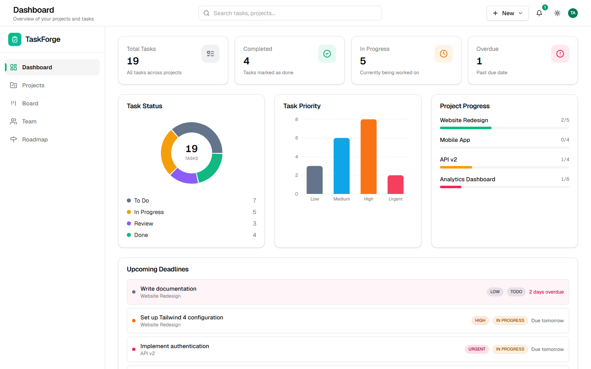
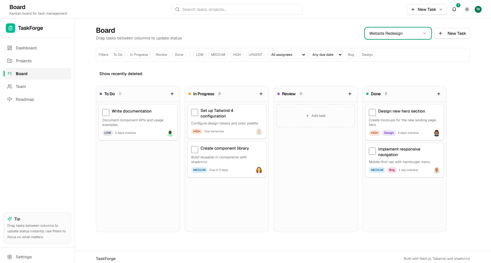
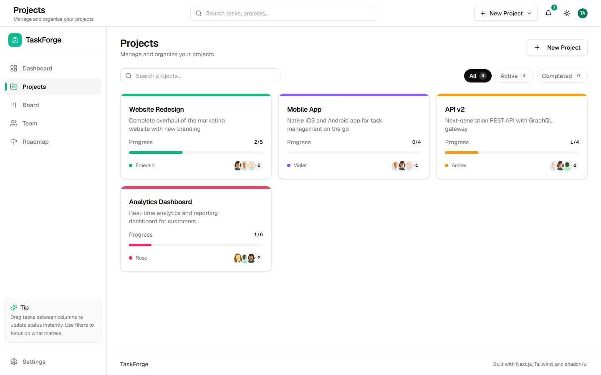
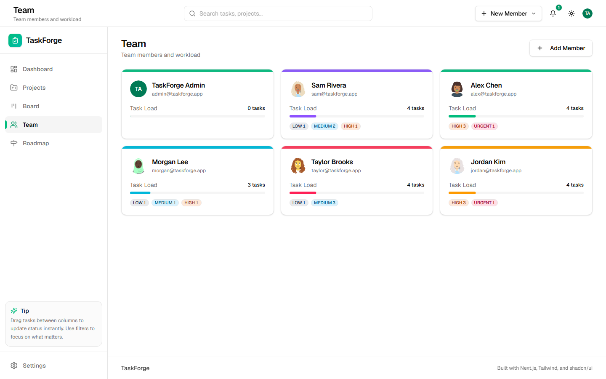
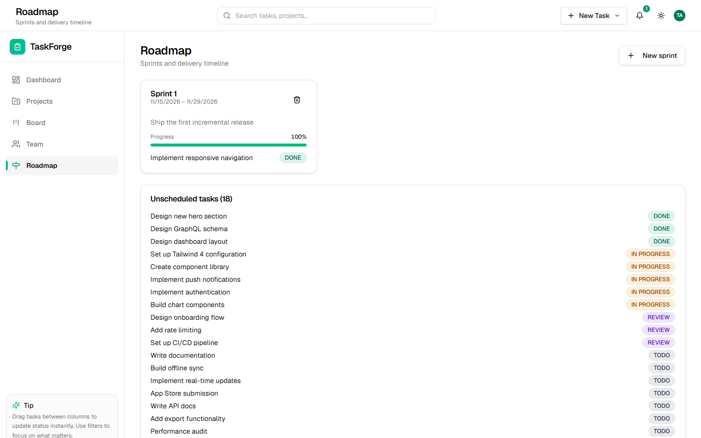
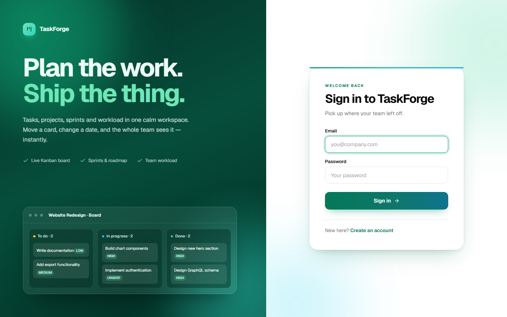
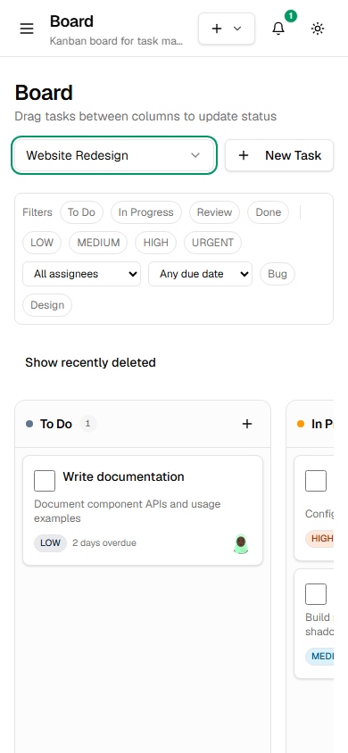

<div align="center">

# 🛠️ TaskForge

**One calm workspace for tasks, projects, sprints, and the people doing the work.**

[](https://github.com/Salar11111/TaskForge/actions/workflows/ci.yml)


</div>

---

## ✨ Why TaskForge?

Task boards tend to start simple and end as a pile of half-connected screens. TaskForge keeps the whole loop in one place: plan the work on a drag-and-drop board, group it into sprints, see who is carrying what, and get a quiet heads-up when a date slips. Everything is scoped to a workspace, so two teams can share one deployment without seeing each other's data.

It is built as a small, readable codebase — no monorepo, no microservices — with the boring parts done properly: validation, authorization, pagination, error handling, and tests.

### 🧩 What's inside

- 📋 **Kanban board** — drag tasks across columns, reorder by pointer or keyboard, and filter by status, priority, assignee, label or due date.
- 🏷️ **Labels & multi-filter** — workspace-scoped labels with toggle chips on cards; filters combine and clear in one click.
- 💬 **Task detail drawer** — comments, a full activity feed and link attachments on every task.
- 🔔 **Notification center** — assignment alerts plus computed due-soon/overdue reminders, with unread counts and mark-all-read.
- 🗓️ **Sprints & roadmap** — delivery windows with progress, goal tracking and an unscheduled-task list.
- ⚡ **Bulk actions & trash** — multi-select to update or delete, with soft-delete and restore from a recently-deleted tray.
- 📊 **Dashboard analytics** — status/priority breakdowns, project progress, workload and deadline trends.
- 👥 **Team workload** — capacity bars, per-member task stats and quick member management.
- ⌘️ **Command palette** — `Ctrl/Cmd + K` to jump between views or create a task.
- 🔄 **Live updates** — workspace-scoped SSE events keep every open tab in sync.

---

## 📸 Screenshots

| 📊 Dashboard | 📋 Kanban board |
|:---:|:---:|
|  |  |

| 📁 Projects | 👥 Team workload |
|:---:|:---:|
|  |  |

| 🗓️ Roadmap | 🔐 Sign in |
|:---:|:---:|
|  |  |

<div align="center">
  
  <p><em>📱 Same board, 390px wide — columns scroll horizontally, navigation collapses into a drawer.</em></p>
</div>

---

## 🚀 Quick start

```bash
npm install
npm run db:push          # create/update prisma/dev.db
npm run db:seed          # demo workspace: 4 projects, tasks, labels, a sprint and more
npm run dev              # http://localhost:3000
```

Sign in with the seeded admin:

> **📧 `admin@taskforge.app`** &nbsp;·&nbsp; **🔑 `TaskForge-2026!`**
>
> Override with `SEED_ADMIN_EMAIL` / `SEED_ADMIN_PASSWORD`. New users can register at `/signup` and will land on `/setup` to create their own workspace.

> 🪟 **Windows note** — stop the dev/prod server before `npm run db:push`; otherwise Prisma can hit an `EPERM` while replacing the query-engine DLL.

---

## 🧱 Stack

| Layer | Choice |
|---|---|
| Framework | Next.js 15 (App Router), React 19 |
| Language | TypeScript 5 (strict) |
| Styling | Tailwind CSS 4, Radix UI primitives, lucide-react |
| Data | Prisma 5 + SQLite |
| Auth | better-auth (email/password, cookie sessions) |
| State | TanStack Query 5 (server data), Zustand (UI state) |
| Interactions | dnd-kit, Recharts, sonner toasts |
| Testing | Vitest, Playwright, Lighthouse |

---

## 🗂 Project structure

```text
app/
  api/                 # route handlers (auth, tasks, projects, users, labels, sprints, …)
  login/ signup/ setup/ settings/   # auth & onboarding pages
  client-shell.tsx     # mounts views, dialogs, palette, detail drawer and SSE listener
components/            # feature views + reusable UI primitives
lib/                   # auth, authz, errors, API client, query keys, store, events
prisma/                # schema and idempotent-ish demo seed
tests/unit/ tests/e2e/ # Vitest + Playwright
```

---

## 🔌 API at a glance

Every data route requires a session and a workspace membership. Handlers are scoped through `lib/authz.ts`; validation is centralised in `lib/validations.ts`; errors are mapped consistently in `lib/api-error.ts`.

| Resource | Endpoints |
|---|---|
| Tasks | `GET/POST /api/tasks`, `GET/PATCH/DELETE /api/tasks/:id`, `PATCH /api/tasks/reorder`, `PATCH /api/tasks/bulk` |
| Task extras | `GET/POST /api/tasks/:id/comments`, `…/activity`, `…/attachments`, `GET /api/tasks/trash`, `POST /api/tasks/:id/restore` |
| Projects | `GET/POST /api/projects`, `GET/PATCH/DELETE /api/projects/:id` |
| People | `GET/POST /api/users`, `GET/PATCH/DELETE /api/users/:id` |
| Labels & sprints | `GET/POST /api/labels`, `GET/PATCH/DELETE /api/labels/:id`, same shape for `/api/sprints` |
| Notifications | `GET /api/notifications`, `PATCH /api/notifications/:id`, `POST /api/notifications/read-all` |
| Other | `/api/stats`, `/api/workspaces`, `/api/realtime` (SSE) |

List endpoints accept `?limit=` (1–500) and `?offset=`, and return the unpaginated total in `X-Total-Count`.

---

## 🔐 Security notes

- 🧾 **Every request is checked** — sessions via better-auth, workspace membership via `requireWorkspace`, and privileged mutations via `requireWorkspaceRole`. The last workspace owner cannot be removed.
- 🧭 **Tenant scoping** — task moves validate the destination project; task stats, aggregates, labels, sprints and trash are all workspace-scoped.
- 🚧 **Validation** — Zod schemas on every JSON body; only http(s) URLs accepted for avatars and attachments; arrays bounded.
- 🛡️ **Headers** — CSP, HSTS, COOP/CORP, `nosniff`, referrer and permissions policies are set in `next.config.js`.
- ⏱️ **Rate limits** — a coarse in-memory Edge limiter for `/api/*`, plus a shared database-backed limiter for auth and workspace creation.
- 🔑 **Secrets required in production** — `BETTER_AUTH_SECRET` (32+ chars) and `BETTER_AUTH_URL` must be set; the app refuses to boot without them.
- 🌱 **Safe seeding** — `npm run db:seed` refuses to run against a production database unless invoked with `--force`.

---

## 📱 Responsive by design

The whole app was audited at **320, 360, 390, 768, 820, 1024, 1280 and 1440px** with zero horizontal overflow. Board columns scroll inside their own container, charts wrap their legends, and dialogs, the detail drawer and the mobile navigation drawer all stay within the viewport. Motion respects `prefers-reduced-motion`.

---

## ✅ Tests & quality

```bash
npm run typecheck     # TypeScript
npm run lint          # ESLint
npm run build         # production build
npm run test:unit     # 32 Vitest tests
npm run test:e2e      # 11 Playwright tests (login, board, signup, authz/IDOR/role checks)
```

Playwright specs are materialised automatically before the run (a workaround for OneDrive placeholders on Windows), and e2e runs with a single worker because the security specs create isolated workspaces in the shared database. CI (`.github/workflows/ci.yml`) runs typecheck, lint, build, unit and e2e jobs.

---

## 🚢 Deployment

1. Set `DATABASE_URL`, `BETTER_AUTH_SECRET`, `BETTER_AUTH_URL` and `NEXT_PUBLIC_APP_URL`.
2. Run `npx prisma db push --skip-generate` against the target database.
3. `npm run build && npm run start`.
4. For multiple instances, point them at the same database — rate-limit counters and sessions are shared there. Replace the in-process event bus with Redis (or similar) before scaling horizontally.

---

## 🗺 Roadmap ideas

- 📎 Real file attachments (currently link metadata only)
- ⏰ Scheduled reminder delivery (reminders are computed on read today)
- 📤 CSV export and public share links
- 🧪 Deeper visual-regression coverage

---

<div align="center">

Made with ☕, TypeScript and a healthy respect for boring infrastructure.

</div>
